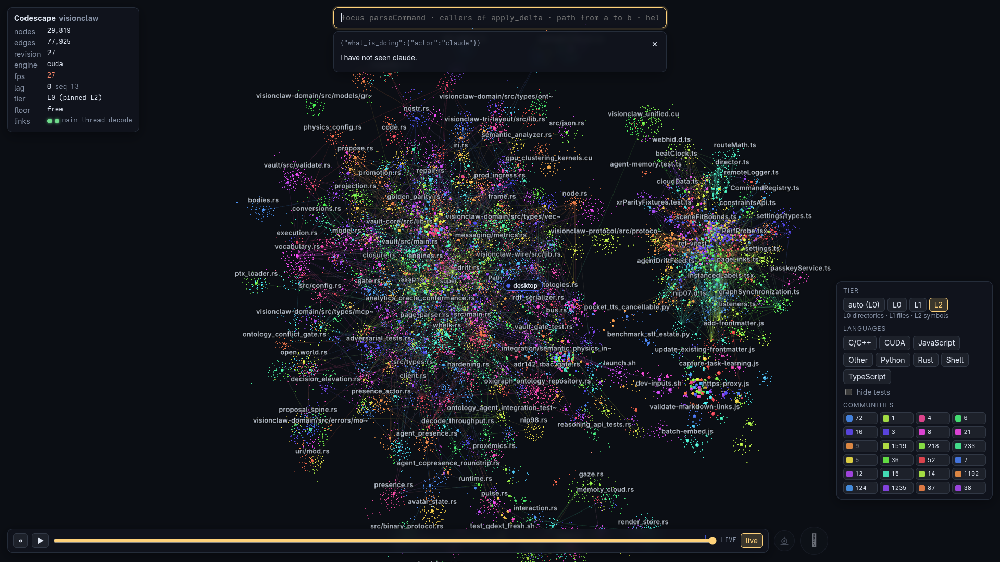
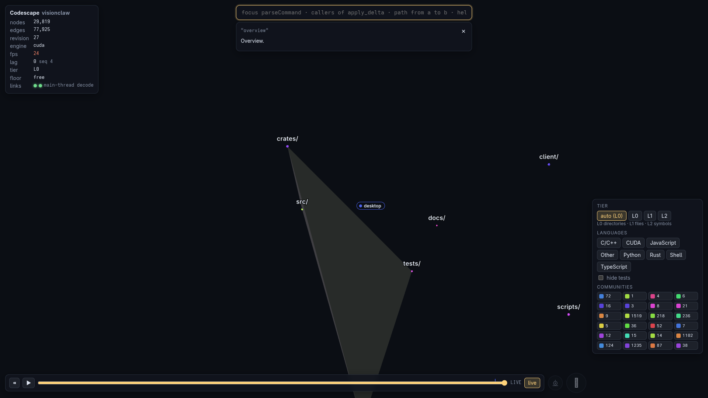
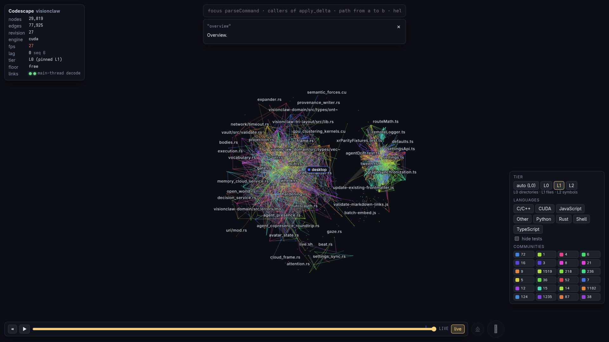
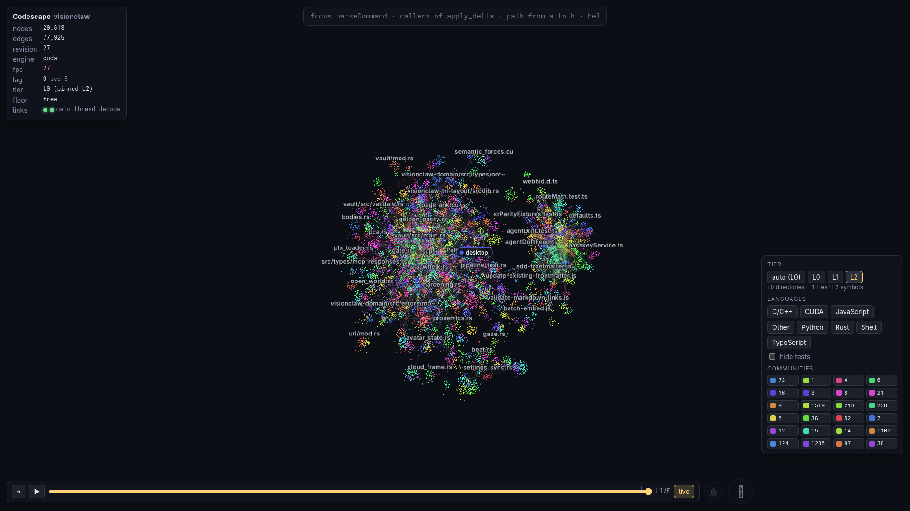
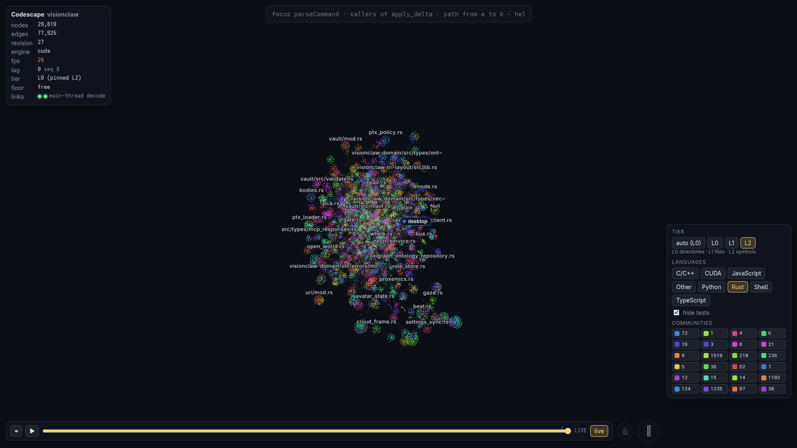
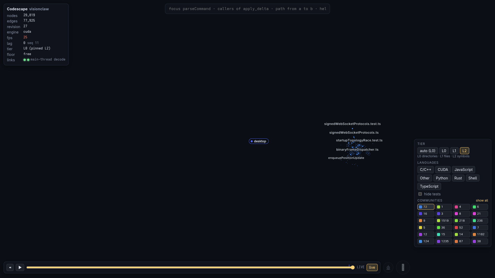
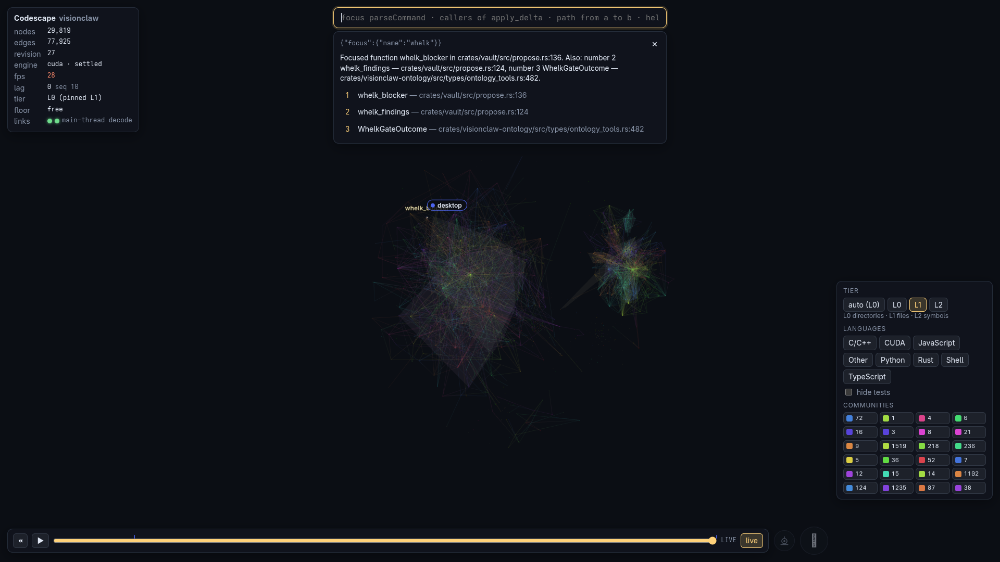
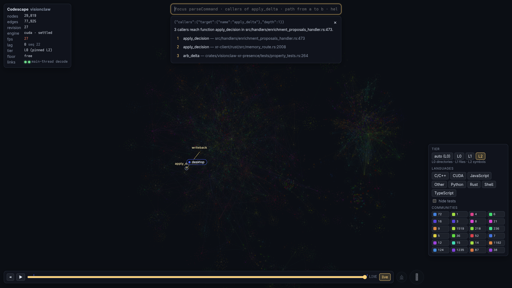
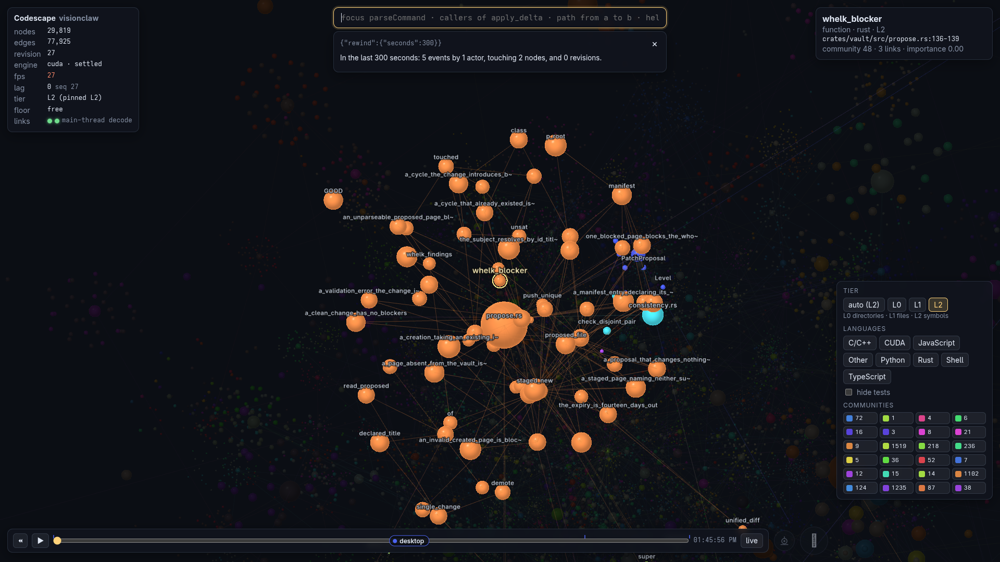
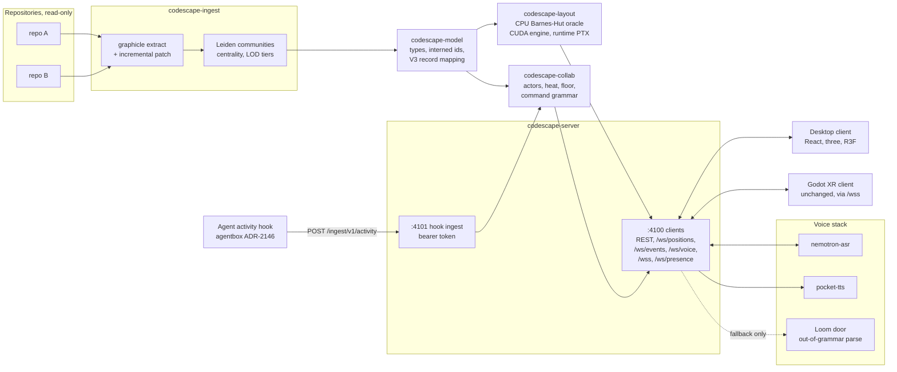

<div align="center">

# Codescape

### A shared spatial view of source code for people and agents

[](LICENSE)
[](Cargo.toml)
[-8b5cf6?style=flat-square)](#crates)
[](#status--honesty)

**Humans and agents work in the same near-real-time 3D view of a codebase, and you steer it by voice.**

**Maintainer**: [John O'Hare](https://github.com/jjohare)

[Architecture](#architecture) · [Crates](#crates) · [Quick start](#quick-start) · [Ecosystem](#where-codescape-sits) · [Status](#status--honesty) · [Docs](docs/README.md)

</div>

---

Codescape extracts a code graph from one or more repositories, lays it out in
3D on the GPU (or the CPU), and streams it to a desktop browser client and a
Godot XR headset client from one port. Agents and people appear in the graph
at the node they are touching, as they touch it. You talk to the scene with
push-to-talk: "focus on the parser", "who calls `parse_config`", "what is
claude doing". Every spoken or typed request becomes a typed command before
anything runs.

Codescape is a code-work tool. It is deliberately separate from the
knowledge-work system it was born beside ([VisionClaw](https://github.com/DreamLab-AI/VisionClaw)):
it reads source trees, never a knowledge corpus, and that separation is a
tested property (see [Security posture](#security-posture)).

---

<div align="center">



*The VisionClaw and agentbox source trees at the symbol tier (L2): 29,819 nodes, 77,925 edges, CUDA layout on an RTX A6000. The Rust backend is the large mass on the left and the TypeScript client the smaller one on the right.*

</div>

---

## See it
The screenshots below were captured for the 19 October 2026 README update from the desktop client at 1920×1080 through browser automation, against the Codescape service running on the CUDA engine. The scene is the real VisionClaw and agentbox checkouts, not a demo dataset.

### Repository scenes and input

A local 21 October development commit adds a collapsible repository panel, estate-scene links and revised SpaceMouse axes. That commit (`ffb98c2`) was not on the published main branch when this documentation update was prepared. These controls remain pending publication; the screenshots below predate them. See [deployment configuration](deploy/README.md) for the published scene and input contract.

<details>
<summary><strong>Captured gallery: tiers, filters, queries and timeline</strong></summary>

### Three levels of detail
The client shows one tier at a time: leave it on `auto` or pin L0, L1 or L2 from the tier panel. L0 shows directories, L1 files, L2 symbols.

| L0, directories | L1, files |
|---|---|
|  |  |



### Filters and communities
Language buttons, `hide tests` and the community chips work on the live scene. Below, Rust only with tests hidden removes the TypeScript client entirely, and community 72 isolates to one cluster of WebSocket and frame-dispatch code.

| Rust only, tests hidden | Community 72 isolated |
|---|---|
|  |  |

### Typed commands
The command box takes the same grammar as push-to-talk ([Voice and typed commands](#voice-and-typed-commands)). Names are resolved fuzzily and the ranked candidates are shown, so a near miss is visible rather than silently wrong.

| `focus on whelk` | `callers of apply_delta` |
|---|---|
|  |  |

### Blast radius and the timeline
`what is affected by whelk_blocker` highlights the 22 nodes within three hops. The inspector (top right) shows the symbol, its file and line span and its community, and `rewind 5 minutes` drives the timeline bar and summarises the window.



Not shown: agent presence (an actor appearing at the node it touches), voice and the XR client. Those need the hook token, the speech services and a headset respectively, and are described in [Status & honesty](#status--honesty).

</details>

---

## Where Codescape sits

Codescape is one section of the [VisionFlow](https://github.com/DreamLab-AI/VisionFlow) mesh. It is a code-work tool: it reads source trees and never a knowledge corpus. It was born inside VisionClaw and is now its own repository ([ADR-0001](docs/adr/ADR-0001-extraction-from-visionclaw.md)).

| Sibling | Relationship |
|---|---|
| [VisionFlow](https://github.com/DreamLab-AI/VisionFlow) | The canon: ecosystem map, compatibility matrix and honest status ledger. |
| [VisionClaw](https://github.com/DreamLab-AI/VisionClaw) | The host deployment. It mounts this repository as the `codescape/` submodule, owns the compose service and nginx route, builds the CUDA PTX, and publishes [`visionclaw-wire`](https://crates.io/crates/visionclaw-wire), the frozen position wire. Its Godot XR client connects through `/wss`. |
| [agentbox](https://github.com/DreamLab-AI/agentbox) | The agent container. The activity-sink hook ([ADR-2146](https://github.com/DreamLab-AI/agentbox/blob/main/docs/adr/ADR-2146-activity-sink-hook.md); merged, default-off) posts agent activity to `:4101`. |
| [loom](https://github.com/DreamLab-AI/loom) | Optional out-of-grammar command parse (`CODESCAPE_LOOM_URL`); voice runs without it. |
| [graphicle](https://github.com/Graphicle-AI/graphicle) | The code-graph extraction engine, used unmodified as a pinned git dependency. |

Standalone use needs none of these: the CPU layout engine, the desktop client and the two permissive crates build and run on their own (see [Quick start](#quick-start)).

---

## Architecture


Positions go out as the frozen 52-byte V3 record inside V5 envelopes, the
same position record VisionClaw’s clients decode. The shared record reduces decoder changes; client connection, presence and device acceptance remain separate integration work. Topology, selections, captions and query results go out as JSON on
`/ws/events`. There is no Codescape-specific wire format.


---

## Crates
| Crate | Role | Licence | Publishable |
|---|---|---|---|
| `codescape-model` | Pure types: nodes, edges, interned 26-bit wire ids, snapshots, deltas, LOD tiers, community matching, V3 record mapping. No I/O. | MIT OR Apache-2.0 | yes |
| `codescape-collab` | Pure collaboration state: actor registry, activity heat, path resolution, the single push-to-talk floor, the command grammar and LLM-fallback schema. No I/O. | MIT OR Apache-2.0 | yes |
| `codescape-ingest` | The graphicle facade: extraction, incremental cache, live patching, communities, centrality, affected/path/search queries. The only crate that uses graphicle. | AGPL-3.0-only | no |
| `codescape-layout` | CPU Barnes-Hut layout (the conformance oracle) and, behind `cuda`, a thin cust driver over runtime-loaded PTX with ABI and provenance checks. | AGPL-3.0-only | no |
| `codescape-server` | actix-web: every network adapter, the static desktop bundle, voice adapters, `/wss` emulation for XR. | AGPL-3.0-only | no |
| `client/` | Desktop browser client (Vite, React, three, React Three Fiber). | AGPL-3.0-only | no |

A permissive crate never depends on an AGPL crate. See [LICENSE](LICENSE).


---

## Quick start
### Standalone, CPU layout

From this repository root, build the browser client first (Node 22.3 or later and Rust 1.94 or later):

```bash
cd client
npm ci --include=dev
npm run build
cd ..
cargo run --release -p codescape-server -- \
  --bind 127.0.0.1 \
  --data-dir ./.codescape \
  --static-dir target/codescape-dist \
  --repo myrepo=/path/to/myrepo
```

Open `http://127.0.0.1:4100/`, select a tier, then try `overview` and `focus on <symbol-name>` in the command box. The path in `--repo` must name the source tree you want to inspect. Voice additionally needs speech services; typed navigation does not.

`--repo` is repeatable (`--repo a=/src/a --repo b=/src/b`). The default data
directory is `/data/codescape`, which is rarely writable on a workstation;
`./.codescape` is gitignored. The CPU engine needs no GPU and no CUDA
toolkit.

### With CUDA

```bash
cargo run --release -p codescape-server --features cuda -- \
  --bind 127.0.0.1 --data-dir ./.codescape --repo myrepo=/path/to/myrepo
# with CODESCAPE_PTX_DIR pointing at a directory holding the unified PTX
# and its ptx-build-manifest.txt
```

The engine refuses PTX whose ABI or build provenance does not match, and falls
back to the CPU engine with the reason shown in `/api/health`.

### Inside VisionClaw

VisionClaw mounts this repository as a git submodule at `codescape/` and owns
the compose service and the nginx location (see [deploy/README.md](deploy/README.md)).

Run from the **VisionClaw** checkout, in its authorised host shell:

```bash
git submodule update --init codescape
CODESCAPE=1 ./scripts/launch.sh up dev
# then browse http://<host>:3001/codescape/
```


---

## Voice and typed commands
Push-to-talk holds a single floor. Speech goes to nemotron-asr; the transcript
is parsed by a deterministic grammar; only an utterance the grammar cannot
parse goes to the Loom door, whose output must pass the command schema or it
is spoken back and never executed. Typed commands use the same grammar.

| Say | Does |
|---|---|
| `focus on X`, `focus` | fly to and select X (or the current pick) |
| `explain X`, `what is X` | retrieve and summarise X |
| `callers of X`, `who calls X` | callers, up to 10 hops |
| `callees of X`, `what is called by X` | callees, up to 10 hops |
| `what is affected by X`, `affected by X`, `what does X affect` | blast radius |
| `path from X to Y`, `path between X and Y` | shortest dependency path |
| `show only rust`, `show only community 3`, `show all`, `hide tests` | filters |
| `zoom in`, `zoom out`, `overview`, `back` | camera |
| `rewind 5 minutes`, `replay`, `live` | timeline (rewind up to 7 days) |
| `what is claude doing`, `what is happening`, `who is here` | presence report |
| `follow claude`, `stop following` | camera follows an actor |
| `ask claude to <task>` | delegate to an agent: parsed today, dispatched only from P6 through a browser-signed intent |

The goldens in `crates/codescape-collab/tests/grammar_golden.rs` are the
authoritative phrase list.


---

<details>
<summary><strong>Configuration reference</strong></summary>

Every flag has a `CODESCAPE_*` environment variable. The main ones:

| Variable | Default | Purpose |
|---|---|---|
| `CODESCAPE_PORT` | `4100` | Client HTTP and WebSocket port |
| `CODESCAPE_INGEST_PORT` | `4101` | Hook-ingest port; never publish it |
| `CODESCAPE_BIND` | `0.0.0.0` | Bind address for both listeners; use `127.0.0.1` outside a container |
| `CODESCAPE_REPO` | required | `label=path`, comma separated |
| `CODESCAPE_EXCLUDES` | none | Extra glob excludes on top of `.gitignore`, comma separated |
| `CODESCAPE_DATA_DIR` | `/data/codescape` | Interner, graphicle cache, positions, timeline |
| `CODESCAPE_STATIC_DIR` | none | Built desktop client served at `/` |
| `CODESCAPE_INGEST_TOKEN_FILE` | none | Bearer token for `:4101`; unset disables the ingest listener |
| `CODESCAPE_PATH_MAP` | none | `FROM=TO[:FROM=TO...]`, rewrites the paths agents report to the paths Codescape reads |
| `CODESCAPE_PREFER_CUDA` | `true` | Use the CUDA engine when compiled in and usable |
| `CODESCAPE_CUDA_DEVICE` | best free | Device ordinal (read by codescape-layout); set `CUDA_DEVICE_ORDER=PCI_BUS_ID` |
| `CODESCAPE_PTX_DIR` | none | Directory holding `visionclaw_unified.ptx` and `ptx-build-manifest.txt`; checked for ABI and provenance at load (ADR-0001) |
| `CODESCAPE_TRUST_PROXY` | `false` | Honour `X-Forwarded-*` from a reverse proxy |
| `CODESCAPE_TRUST_PROXY_FROM` | any peer | Peers (IPs, CIDRs, hostnames) whose forwarded headers are trusted; requires `TRUST_PROXY` |
| `CODESCAPE_PUBLIC_PATH_PREFIX` | empty | Prefix the proxy strips, such as `/codescape` |
| `CODESCAPE_ALLOWED_ORIGINS` | same origin + loopback | Extra browser origins allowed to open WebSockets |
| `CODESCAPE_ASR_URL` | `ws://nemotron-asr:8000/api/asr-streaming` | Streaming speech recognition |
| `CODESCAPE_TTS_URL` | `http://pocket-tts:8000` | Speech synthesis |
| `CODESCAPE_LOOM_URL` | none | OpenAI-compatible `.../v1` base for the out-of-grammar fallback; unset disables it |
| `CODESCAPE_SHARE_AGENT_TEXT` | `false` | Show agents' prompt and answer text to every viewer (default: tool names only) |

`codescape-server --help` lists the rest (`FRAME_HZ`, `LOOM_MODEL`,
`TTS_VOICE`, `PUBLIC_ORIGIN`, `REEXTRACT`, `INCLUDE_DOCS`, `LOG_LEVEL` and the
P6 auth flags).


---

</details>

### Jev option

An opt-in System One (TypeSafe Jev) Choice sits between the grammar and Loom. When the grammar returns no match, Jev may select one of the grammar's own argument-free commands (`show_all`, `hide_tests`, `zoom_in`, `zoom_out`, `overview`, `back`, `replay`, `live`, `stop_following`, `help`) or `none`. It never names a target or supplies arguments. `none`, any failure (flag off, no endpoint, timeout, transport error, non-2xx, malformed reply, out-of-set choice) or a confidence below the threshold leaves today's Loom path unchanged. A grammar hit, an empty utterance and an invalid command never reach Jev.

- **Off by default.** `CODESCAPE_JEV=1` enables it.
- **What leaves:** only the normalised utterance (at most 512 characters). No repository content.
- **Destination:** `CODESCAPE_JEV_ENDPOINT` (+ `CODESCAPE_JEV_MODEL`, key from the variable named by `CODESCAPE_JEV_KEY_ENV`); else the agentbox loopback proxy (`AGENTBOX_SYSTEM_ONE_PROXY=1` with `AGENTBOX_SYSTEM_ONE_ENDPOINT`/`_MODEL`, or the `AGENTBOX_SKILL_ROUTE_*` pair; no Authorization header); else `https://api.typesafe.ai/v1/systemone` with `TYPESAFE_API_KEY`. The resolved URL is added to the egress allowlist only when enabled.
- **Local-only by default.** The proxy and public API need `AGENTBOX_SYSTEM_ONE_BACKEND_LOCAL=1` or `CODESCAPE_JEV_LOCAL=1`; `CODESCAPE_JEV_ALLOW_CLOUD=1` accepts a non-local endpoint.
- **Threshold:** `CODESCAPE_JEV_MIN_CONFIDENCE` defaults to `1.0`, which accepts nothing automatically. Lower it only from labelled data.
- **Deadline:** `CODESCAPE_JEV_TIMEOUT_MS`, default 3000, capped at 4000, no retries.

Wiring and fallback tests only; no measured uplift.

## Security posture
- **Authentication is open until P6.** `/api/health` reports `"auth":"open"`.
  NIP-98 and the allowlist remain planned. `--require-auth` currently refuses startup; it does not enable a verifier ([source](crates/codescape-server/src/auth.rs)). Until then, do not
  expose `:4100` to a network you do not trust. Under VisionClaw the port is
  published on host loopback only; the dev nginx path `/codescape/` on `:3001`
  is a recorded dev-only owner waiver.
- **Hook ingest** on `:4101` takes a constant-time-compared bearer token and
  is never published outside the container network.
- **Isolation from knowledge-work systems** is enforced in layers
  ([docs/BASELINE-codescape.md](docs/BASELINE-codescape.md)):
  1. the resolved build graph contains no ontology, memory, vault, Oxigraph,
     Postgres, RuVector, Solid or VisionClaw-server crate, no `visionclaw-*`
     crate but `visionclaw-wire`, nothing from the VisionClaw repository, and
     no AGPL crate under a permissive one (tests);
  2. the server exits 2 at boot if `RUVECTOR_PG_CONNINFO` is set (test);
  3. the client imports nothing outside its own tree and an allowlist of
     packages (test);
  4. its container mounts source directories read-only and never a corpus
     (deployment contract);
  5. outbound connections go through one allowlist: ASR, TTS, the Loom door
     and, from P6, the voice-intent endpoint (code; an egress test is open).
- **No signing keys.** Agent dispatch, when it lands, is a kind-31402 event
  signed in the browser and relayed, never signed by the server.


---

## Building and testing
```bash
cargo test --workspace --locked                  # CPU only; incl. the isolation suite
cargo clippy --workspace --all-targets -- -D warnings
cargo test --workspace --features codescape-server/cuda   # needs a CUDA toolkit to link, no device

cd client && npm ci && npm run typecheck && npm test && npm run build
```

`AGENTS.md` has the full list. CI (`.github/workflows/ci.yml`) runs all of it.


---

## Status & honesty

**Publication checked 21 October 2026 against main `e300451`.** Local development at `ffb98c2` adds the repository panel, scene links and SpaceMouse mapping; this documentation publication leaves that feature commit unmerged. The phase evidence below records earlier runs; its counts and hardware observations are not fresh results for this revision.

| Phase | State |
|---|---|
| P0 Spine | landed |
| P1 Pixels | landed: gate of 197 Rust tests and 60 client tests green, clippy, fmt and rustdoc clean. Performance and conformance numbers were reported by workers and not yet re-run |
| P2 GPU, live, own service | not gated: the CUDA engine and compose service exist; the committed GPU conformance run and an egress test are open |
| P3 Presence and scale | not gated: hook ingest drove an actor by hand; 100k-node evidence open |
| P4 XR | partial: the Godot client rendered Codescape at 90 FPS on a headset on 17 and 21 October; since VisionClaw ADR-2143 A6 it carries a Codescape mode (capability table, greyed controls, the desktop community palette) with no wire change; `/ws/presence` is a handshake shim |
| P5 Voice | not gated: one spoken round trip (ASR, grammar, answer, TTS) observed; the goldens and contention evidence are open |
| P6 Publish and dispatch | pending: TLS, NIP-98, allowlist, signed dispatch |

The recorded 18 October host setup serves `/codescape/` through VisionClaw’s development nginx on port 3001 (ADR-2143 A4). The evidence index links the earlier headset run. This README review has not revalidated the running host, current GPU conformance or headset behaviour.

Earlier reported 100k-node figures (7.8 ms GPU step and 13.7 s cold settle) miss the 5 ms / 10 s targets. The evidence index says performance and conformance numbers were reported without a committed rerun; treat them as provisional, not certified measurements. Evidence:
[docs/evidence/README.md](docs/evidence/README.md).

Things to know before relying on it:

- The CUDA layout engine drives VisionClaw's `visionclaw_unified` PTX (a 53-field `SimParams` mirror and the `thrust_sort_key_value` contract). Without that PTX, the CPU Barnes-Hut engine runs.
- The deploy contract ([deploy/README.md](deploy/README.md)) is VisionClaw-shaped. Another host writes its own compose and proxy configuration.
- This is v0.1.0 with a short history: the repository was imported with fresh history ([Provenance](#provenance)).


---

## Provenance
Codescape was designed and built inside VisionClaw under [ADR-2143](https://github.com/DreamLab-AI/VisionClaw/blob/main/docs/adr/ADR-2143-codescape-section-separate-workspace-and-port.md) ("Codescape
is a separate section with its own Cargo workspace, its own port and a tested
isolation boundary") and its amendments A1 to A4, on the `feat/codescape`
branch from commit `b63068e3d`. It was imported into this repository with a
fresh history from VisionClaw [`cac36a028`](https://github.com/DreamLab-AI/VisionClaw/commit/cac36a028) on `main` (source range
`b63068e3d^..cac36a028`); [ADR-0001](docs/adr/ADR-0001-extraction-from-visionclaw.md)
records why and how, and [docs/evidence/import-gate.txt](docs/evidence/import-gate.txt)
holds the import gate output.

The code-graph engine is [graphicle](https://github.com/Graphicle-AI/graphicle),
a Rust port of Graphify, licensed Apache-2.0 and used unmodified as a pinned git
dependency (rev `003f93605d895ed69f0cf06690dd296474385b99`).


---

## Documentation
Index: [docs/README.md](docs/README.md) · governing document: [BASELINE-codescape.md](docs/BASELINE-codescape.md) · decisions: [docs/adr](docs/adr/README.md) · evidence: [docs/evidence](docs/evidence/README.md) · deployment contract: [deploy/README.md](deploy/README.md) · desktop client: [client/README.md](client/README.md) · agent instructions: [AGENTS.md](AGENTS.md).

---

## Licence

Per directory; see [LICENSE](LICENSE). `codescape-model` and `codescape-collab`
are MIT OR Apache-2.0; everything else is AGPL-3.0-only.

Corpus and data terms do not apply: Codescape reads source trees only.

---

<div align="center">

**Part of [VisionFlow](https://github.com/DreamLab-AI/VisionFlow)**: Codescape shows the code; [VisionClaw](https://github.com/DreamLab-AI/VisionClaw) hosts it and reasons over the knowledge corpus; [agentbox](https://github.com/DreamLab-AI/agentbox) runs the agents whose activity appears in the scene; [loom](https://github.com/DreamLab-AI/loom) grounds the model behind the door; [solid-pod-rs](https://github.com/DreamLab-AI/solid-pod-rs) stores sovereignly; the [forum](https://github.com/DreamLab-AI/nostr-rust-forum) and [website](https://github.com/DreamLab-AI/dreamlab-ai-website) provide governance and operator surfaces.

[Documentation](docs/README.md) · [Issues](https://github.com/DreamLab-AI/codescape/issues) · [Evidence](docs/evidence/README.md)

</div>
