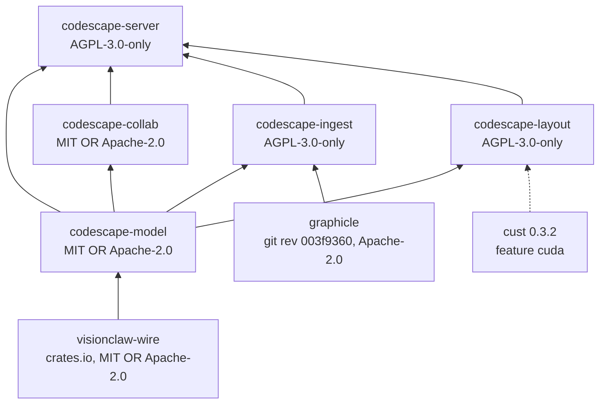
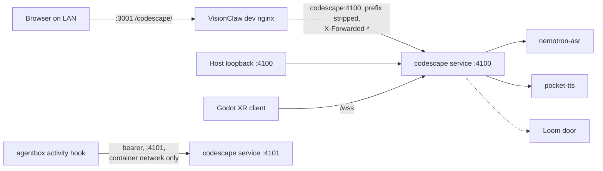

# BASELINE: Codescape

> Living governing document. Its *Invariants* section is the compliance surface. Amend it only together with a record in [`adr/`](adr/README.md), in the same change.

**Status at writing (2026-10-18).** Repository skeleton; the code is imported from VisionClaw next (ADR-0001). Citations below give the enforcing test's current location in the VisionClaw tree (branch `feat/codescape`) and the path it will have here. Line numbers are the VisionClaw working-tree lines recorded in ADR-2143 A2; refresh them to this repository after import.

## Purpose and scope

Codescape is a near-real-time 3D view of a codebase that humans and agents share. It extracts a code graph (graphicle), lays it out (CPU Barnes-Hut or CUDA), streams positions on the frozen V3/V5 wire to a desktop client and to the unchanged Godot XR client, shows who is touching what from agent activity hooks, and takes push-to-talk voice and typed commands that are parsed into typed commands before anything runs.

Out of scope, permanently: any knowledge corpus, ontology, memory store or knowledge route. Codescape is a code-work tool.

## Crate DAG

Arrows point from dependency to dependent. Rules:

- `codescape-model` and `codescape-collab` are I/O-free and permissively licensed; they depend on nothing AGPL and on nothing that does I/O. `cargo tree -p codescape-model` and `-p codescape-collab` show no graphicle.
- `codescape-ingest` is the only crate that depends on graphicle, and no graphicle type crosses its public API.
- `codescape-layout`'s `cuda` feature depends on `cust` only; the PTX is read at runtime from `CODESCAPE_PTX_DIR`. (In VisionClaw it depended on `visionclaw-gpu` for compiled-in PTX; that edge is removed at import.)
- `codescape-server` holds every network adapter.
- A sixth crate would need a Codescape wire format, which is forbidden.

## Wire mapping

Codescape produces VisionClaw's frozen V3 record (52 bytes) inside V5 envelopes (`1 + 8 + 52n` bytes) on `/ws/positions`, and the same frames through `/wss` emulation for the XR client. The record layout and its fixtures come from `visionclaw-wire`.

| V3 field | Offset | Code-graph meaning |
|---|---|---|
| `wire_id` | 0 | interned 26-bit id; actors add `AGENT_FLAG` `0x8000_0000`; code nodes carry no flag bits; bit 29 stays free |
| position `x,y,z` | 4 | layout output |
| velocity `vx,vy,vz` | 16 | layout output |
| `sssp_distance` | 28 | BFS hops from the focused node |
| `sssp_parent` | 32 | BFS parent towards the focused node |
| `cluster_id` | 36 | crate or top-level directory |
| `anomaly` | 40 | activity heat, 0..1 |
| `community_id` | 44 | Leiden community, stable-matched across recomputes |
| `centrality` | 48 | importance, 0..1 |

Other frames: `0x23` agent action with the existing `AgentActionType` values; `0x34` acks pace the sender; `initialGraphLoad` (text) carries file-tier topology to XR; `0x43` pose frames on `/ws/presence`. Topology, selection, captions and query results are JSON on `/ws/events`.

## Invariants

| # | Invariant | Enforced by (VisionClaw today) | Path here | State |
|---|---|---|---|---|
| I1 | No forbidden crate in the resolved build graph, default and `cuda` features: no ontology, memory-cloud, vault, Oxigraph, Postgres, RuVector, Solid or VisionClaw server crate | `crates/codescape/codescape-server/tests/isolation.rs:12-33,99-112`, cuda graph `:114-131` | `crates/codescape-server/tests/isolation.rs` | enforced; gap: scans package names only. The negative control builds against VisionClaw's `visionclaw-ontology` by sibling path (`:133-142`) and needs a self-contained fixture after import |
| I1a | The only `visionclaw-*` crate in any feature set is `visionclaw-wire` | none: today's test bans named crates and its cuda case asserts `visionclaw-gpu` *is* present | `crates/codescape-server/tests/isolation.rs` | **added at import**: a `visionclaw-` prefix ban with a `visionclaw-wire` exception, and the cuda assertion inverted |
| I2 | Records are byte-identical to the frozen fixtures: 52 B, `cluster@36`, `anomaly@40`, `community@44`, `centrality@48`, V5 = 1+8+52n | `crates/codescape/codescape-model/src/wire.rs:141-171`, fixtures by `#[path]` `:18-19` | `crates/codescape-model/src/wire.rs`, fixtures from `visionclaw-wire` | enforced |
| I3 | Actors carry `AGENT_FLAG`; code records carry none | `codescape-model/src/wire.rs:173-178` | `crates/codescape-model/src/wire.rs` | enforced at helper level (a second encoding path could bypass) |
| I4 | `0x34` ack bytes equal the shared fixture | `codescape-model/src/wire.rs:180-191`; client `protocol.test.ts` imports VisionClaw's `client/src/types/binaryProtocol.ts` | `crates/codescape-model/src/wire.rs`; client side open | enforced at helper level; client fixture source open |
| I5 | Ids are monotonic and stable, survive byte and serde round trips, exhaustion errors instead of wrapping, a hostile count is refused before allocation | `codescape-model/src/ids.rs` tests `:221,237,249,274,287,304,315` | `crates/codescape-model/src/ids.rs` | enforced |
| I6 | Codescape keeps its own `Cargo.lock` and is never a member of another workspace | own `[workspace]` in `crates/codescape/Cargo.toml` | root `Cargo.toml` | structural (separate repository) |
| I7 | PTX is refused unless `c_params` is 212 B, the launched kernels' arities match (`force_pass_kernel` 30, `cluster_cohesion_kernel` 13, `integrate_pass_kernel` 24) and `ptx-build-manifest.txt` says `provenance=compiled` with a content tag matching the file | `codescape-layout/src/abi.rs:31,33-41,100,184-206`; tag `cuda.rs:459-472` | `crates/codescape-layout/src/{abi,ptx_source,cuda}.rs` | enforced; gap: a hand-written manifest passes. For runtime-loaded PTX the same checks run in `ptx_source.rs` (VisionClaw A5, in progress), with `content_tag` (FNV-1a 64) copied byte-exactly from `visionclaw-gpu` and pinned by test vectors; a drift there refuses every valid PTX |
| I8 | `RUVECTOR_PG_CONNINFO` set means the server exits 2 at boot | `codescape-server/src/config.rs`, `main.rs`; test spawns the binary `tests/isolation.rs:156-187` | `crates/codescape-server/tests/isolation.rs` | enforced |
| I9 | `client/**` reaches no file outside itself (VisionClaw exception: `client/src/types/binaryProtocol.ts`, tests only) and only allowlisted packages | `client/src/codescape/src/__tests__/isolation.test.ts:18-21,73-117` | `client/src/__tests__/isolation.test.ts` | enforced; the exception must be replaced at import |
| I10 | No git dependency on the VisionClaw repository from any crate (its history is about 72 GB). Same number as ADR-2143 A5 | none yet | a `cargo metadata` check for `git+` sources naming VisionClaw, added at import | **not enforced** |
| I11 | A permissively licensed crate depends on no AGPL crate | none yet | a licence check over `cargo metadata`, added at import | **not enforced** |

Not invariants yet (recorded so nobody cites them as enforced):

- **GPU conforms to the CPU oracle** (files k-NN overlap at least 0.9; symbols at least the CPU self-baseline minus 0.1). The `#[ignore]` test `gpu_conforms_to_cpu_oracle` is a required P2 gate step with committed output, not an invariant.
- **Egress allowlist and no corpus mount.** `codescape-server/src/egress.rs` holds the allowlist, but no test proves the process cannot reach anything else, and compose non-publication is not an egress boundary. Open until an egress test exists.

## Deployment topology

- One process, two listeners: `:4100` for clients, `:4101` for hook ingest. `:4101` is never published.
- In VisionClaw, Codescape is its own compose service, built from the `codescape/` submodule, with source directories mounted read-only, its own cargo caches, `cap_drop: ALL` plus `DAC_READ_SEARCH` (to read the compose secret), and `:4100` published on host loopback only. The dev nginx reaches it as a network peer. The full contract is [`../deploy/README.md`](../deploy/README.md).
- Standalone, it is one binary with `--bind 127.0.0.1`.

## Open items

- **Performance targets** (100k nodes): GPU step 5 ms, measured 7.8 ms (kernels 1.7 ms); cold settle 10 s, measured 13.7 s on GPU and 56.6 s on CPU. Cause identified as host-side work per step. Numbers were reported by workers, not re-run; re-run here after import.
- **Presence shim gaps** (P4): `/ws/presence` speaks the XR handshake but carries no avatars between clients; the XR agent hover label is empty.
- **XR actor labels**: XR actors show the 64-character pubkey; they should carry a short display label, as the desktop halo label does.
- **Initial camera framing**: at L0 the auto tier's first framing can land inside a community hull.
- **P6 Publish and dispatch**: TLS and NIP-98 on every route, pubkey allowlist, published `:4100`, the kind-31402 relay to `/v1/voice-intent`. Until then auth is open and `:4100` stays on loopback (dev nginx waiver aside).
- **Audit gaps** (ADR-2143 A2.5): bearer scheme match is case-sensitive beyond `Bearer`/`bearer`; the rate limiter is one shared bucket with no constructor validation.
- **Import couplings** (tracked in VisionClaw ADR-2143 A5): the wire fixtures move to `visionclaw-wire` and the PTX to `CODESCAPE_PTX_DIR` (both in progress in VisionClaw's working tree); the I1 negative-control fixture; the client test import of VisionClaw's `binaryProtocol.ts` (source undecided); the I1a, I10 and I11 checks.

## Change process

A change that alters an invariant, the crate DAG, the wire mapping or the deployment contract needs an ADR in `adr/` and an edit here in the same commit. Review triggers: a graphicle rev bump; any change to the V3 record, V5 envelope or `0x23`; a new egress target or published port; a new crate; a licence change.
